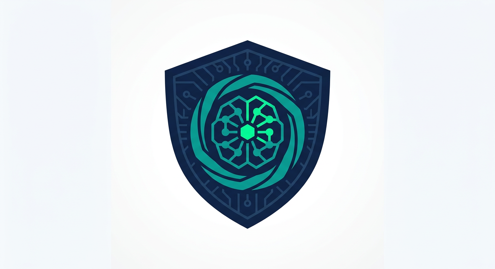

<p align="center">
    
</p>

<p align="center">
    <strong>Step-aware loop braking, atomic multi-tenant budgets, and graceful model downshift for Laravel AI agents and MCP tool servers.</strong>
</p>

<p align="center">
    <a href="https://packagist.org/packages/imgul/laravel-agent-guard"></a>
    <a href="https://github.com/imgul/laravel-agent-guard/blob/main/LICENSE"></a>
    <a href="https://github.com/imgul/laravel-agent-guard/actions"></a>
    <a href="https://packagist.org/packages/imgul/laravel-agent-guard/stats"></a>
</p>

---

## The problem

A runaway agent loop is the costliest failure mode in production AI systems. A multi-step retry spiral can burn tens of thousands of dollars over a few days while health checks keep reporting healthy. Existing guardrails fail hard at the request boundary with 500s, 503s, or exceptions — or estimate tokens at the HTTP wire. None operate per step, and none downshift the model mid-run.

**`laravel-agent-guard`** is a runtime-safety layer that runs *inside* `laravel/ai`'s per-step `PendingStep` pipeline and wraps `laravel/mcp` tool execution. Instead of failing at the boundary, it brakes the agent's generation loop at every step and degrades gracefully when spend or loops run away.

## What it does

The package delivers three capabilities, each independently configurable:

**Step-aware loop & context-growth braking.** Four detectors run in a sliding window: exact-repeat, normalized-argument, frequency, and context-growth (step-over-step input-token growth with no progress). A circuit breaker moves through `CLOSED → OPEN → HALF_OPEN` with configurable cooldown, and a kill switch halts execution instantly — per run or per tenant.

**Atomic multi-tenant budgets.** Four scopes — `run`, `agent`, `tenant`, `tool` — enforced in both USD and tokens. Budget reservations are atomic via Redis Lua scripts, so concurrent Horizon workers can never collectively race past a hard cap. The race condition (TOCTOU) is solved at the storage layer.

**Graceful model downshift.** On a soft-cap breach, the next step is swapped to a cheaper model via `PendingStep::withModel()`, with optional tool and step-count tightening. The agent keeps producing a degraded-but-usable response instead of throwing an exception at a paying customer.

It ships in **observe mode** by default: every detector runs, every event fires, nothing is enforced. Flip `AGENT_GUARD_MODE=enforce` to activate the action ladder. Adoption is zero-breakage.

## Requirements

- PHP **8.3+**
- Laravel **12 / 13**
- `laravel/ai` **^1.0**
- `laravel/mcp` **^1.0**
- Redis recommended (a documented database fallback driver is included)

## Installation

```bash
composer require imgul/laravel-agent-guard
```

Publish the configuration file to customise detectors, budgets, and the downshift ladder:

```bash
php artisan vendor:publish --tag=agent-guard-config
```

## Quick start

Attach the step middleware to any `laravel/ai` agent. Budgets are a map of scope → `[softCap, hardCap]`, with an optional third element specifying the unit (`'usd'` or `'tokens'`):

```php
use Imgul\AgentGuard\Middleware\GuardAgentSteps;

public function middleware(): array
{
    return [
        GuardAgentSteps::make()
            ->forTenant(fn () => tenant()->id)
            ->budget([
                'run'    => [0.25, 0.50],           // soft, hard (USD)
                'tenant' => [15.00, 20.00, 'usd'], // soft, hard, unit
            ])
            ->downshiftAt(0.80, toModel: 'claude-haiku-4-5', withoutTools: ['DeepWebSearch'])
            ->breakLoops(maxRepeats: 3, maxStepGrowthRatio: 2.5)
            ->enforce(), // omit for observe-only
    ];
}
```

Guard an MCP tool with the same tenant budget, loop detector, and kill switch:

```php
use Imgul\AgentGuard\Mcp\GuardedMcpTool;
use Laravel\Mcp\Server\Tool;

class QueryWarehouseTool extends Tool
{
    use GuardedMcpTool;

    protected function guardBudget(): array
    {
        return ['tool_daily_calls' => 100, 'max_repeats' => 3];
    }
}
```

## Operational controls

Inspect and intervene at runtime without touching code:

```bash
php artisan agent-guard:status              # global overview
php artisan agent-guard:status acme         # budgets, breaker & kill-switch for a tenant
php artisan agent-guard:kill --tenant=acme # open the kill switch (incident response)
php artisan agent-guard:budgets acme       # per-scope spend vs caps
```

The same surface is available from code via the facade:

```php
use Imgul\AgentGuard\Facades\AgentGuard;

AgentGuard::kill($tenantId);          // hard-halt a tenant
AgentGuard::unkill($tenantId);        // release it
AgentGuard::status($tenantId);        // budgets, breaker, kill-switch state
AgentGuard::budgets($tenantId);       // per-scope spend summary
```

## Testing

Swap in the fake and assert on every recorded decision — no Redis, no side effects:

```php
AgentGuard::fake();

// ... exercise a guarded agent or MCP tool ...

AgentGuard::assertLoopDetected(tool: 'search');
AgentGuard::assertDownshifted(from: 'claude-opus-4-1', to: 'claude-haiku-4-5');
AgentGuard::assertBudgetSoftCapReached(scope: 'tenant');
AgentGuard::assertKillSwitchActivated(tenant: $tenantId);
AgentGuard::assertNothingDenied();
```

## Domain events

The package fires events for every safety decision, so you can wire your own observability, logging, or alerting:

| Event | Fired when |
|---|---|
| `LoopDetected` | A loop detector trips |
| `BudgetSoftCapReached` | Spend crosses the soft cap for a scope |
| `BudgetHardCapReached` | Spend crosses the hard cap for a scope |
| `ModelDownshifted` | The model is swapped to a cheaper tier |
| `CircuitTripped` | The circuit breaker transitions to `OPEN` |
| `KillSwitchActivated` | A kill switch is opened for a run or tenant |

## Configuration

The published `config/agent-guard.php` controls all behaviour:

| Key | Default | Description |
|---|---|---|
| `mode` | `observe` | `observe` runs all detectors and fires events without enforcement. `enforce` activates the action ladder. |
| `driver` | `redis` | Ledger driver: `redis` (atomic Lua reservations) or `database` (row locks, weaker concurrency). |
| `kill_switch` | `true` | Master toggle for the kill-switch system. |
| `loop.window_size` | `50` | Sliding-window size (in calls) for fingerprint and frequency detection. |
| `loop.max_repeats` | `3` | Same normalized fingerprint repeated this many times trips the breaker. |
| `loop.max_step_growth_ratio` | `2.5` | Step-over-step input-token growth ratio that triggers context-growth detection. |
| `loop.similarity` | `simhash` | Local similarity strategy: `simhash`, `trigram`, or an adapter class. |
| `loop.breaker.cooldown_seconds` | `60` | How long the breaker stays `OPEN` before allowing a half-open probe. |
| `budget.defaults` | — | Default caps per scope. `null` means unlimited. |
| `budget.action_ladder` | — | Soft-cap and hard-cap actions: `downshift` and `halt`. |
| `downshift.ladders` | — | Ordered tiers applied on soft-cap breach, each swapping the model and tightening tools/steps. |
| `pricing.catalog` | `prices.json` | Versioned pricing data, never hardcoded in release tags. |
| `pricing.allow_overrides` | `true` | Runtime/DB overrides take precedence over the catalog. |

## Benchmarks

Two benchmarks ship in [`benchmarks/`](benchmarks/):

- **[`loop-budget-bench.php`](benchmarks/loop-budget-bench.php)** — the 5-step loop reproducer: runs a runaway loop with and without the guard and reports tokens saved, USD saved, and the outcome (unbounded spiral vs. graceful degraded response).
- **[`loop-budget-microbench.php`](benchmarks/loop-budget-microbench.php)** — per-step hot-path throughput (loop detection, budget reserve/reconcile) for performance regression tracking.

```bash
php benchmarks/loop-budget-bench.php                  # the loop reproducer
php benchmarks/loop-budget-microbench.php --runs=200000
```

See [`docs/benchmarks.md`](docs/benchmarks.md) for methodology and representative numbers.

## What it is not

`laravel-agent-guard` owns **runtime execution and spend safety**. It is a complement, not a replacement:

- **Authorization, allowlists, human approval** → `laravel/ai` `Approvable`, `laravel-umpire`, `laravel-mcp-guard`
- **Behavioural trust scoring and hash-chained receipts** → deferred to v2
- **PII/egress redaction, credential vaulting, sandboxing, tool-poisoning scanning** → out of scope

If the failure you are afraid of is *the agent looping and burning money*, this package is the one. If the failure is *the agent doing something it should not have been allowed to do*, reach for an authorization package first — and compose them. See [`docs/comparisons.md`](docs/comparisons.md) for the full matrix and [`docs/composition.md`](docs/composition.md) for recipes.

## Contributing

Contributions are welcome. Please read [CONTRIBUTING.md](CONTRIBUTING.md) for the development setup, coding standards, and pull-request process. All contributors are expected to abide by the [Code of Conduct](CODE_OF_CONDUCT.md).

## License

`laravel-agent-guard` is open-sourced software licensed under the [MIT license](LICENSE).
